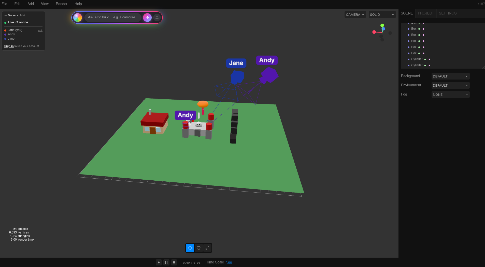
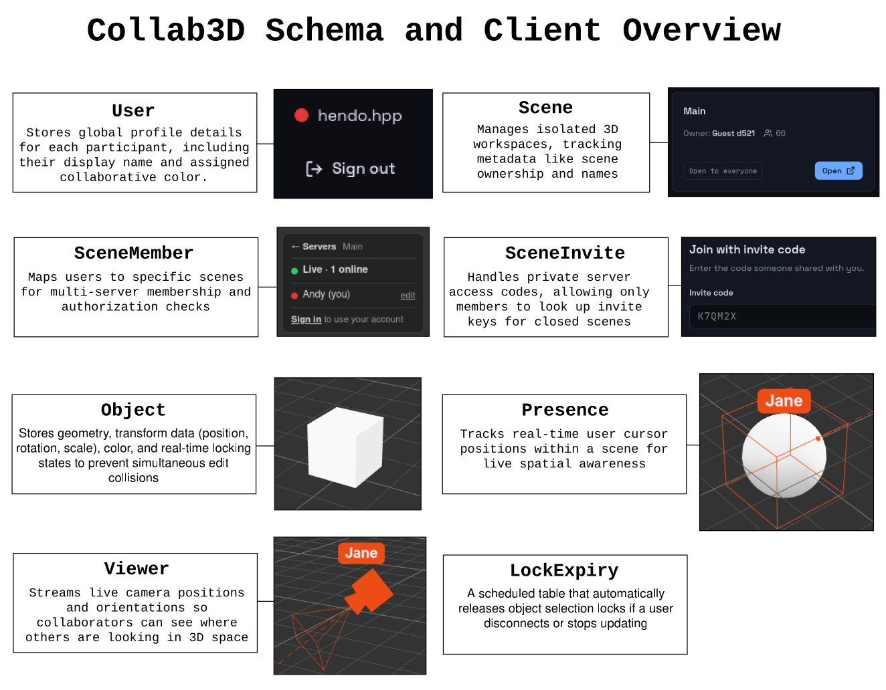

# Collab3D

A real-time collaborative 3D scene builder built on SpacetimeDB and Three.js. Designed for animators, artists, engineers, and anyone interested in collaborative 3D modeling. Unlike traditional workflow pipelines, every user directly edits a single source of truth in real time; no merge conflicts, no constant uploading and downloading.

Live Demo: https://hackutd-2026.vercel.app/ (valid for duration of hack-a-thon)

Database: collab3d on SpacetimeDB Maincloud

## Architecture (The 5 Pillars)

### Database w/ Spacetime

SpacetimeDB serves as the single source of truth for the application state.

* **Object**: Stores geometry, transform (position, rotation, scale), color, and locking metadata.
* **Scene**, **SceneMember**, **SceneInvite**: Manages multi-scene isolation and private server memberships.
* **Presence**, **Viewer**: Tracks live user cursors and camera orientations so collaborators see each other move in real time.
* **LockExpiry**: A scheduled table driving automated lock cleanup (in case of errorneous disconnections).

### Backend w/ Spacetime Reducers in Rust

All state mutations happen through server-side Rust reducers.

* Reducers guarantee that state transitions are atomic, validated, and broadcasted to all connected clients simultaneously.
* Selecting an object invokes `lock_object`, granting exclusive edit rights. `expire_lock` handles releasing the lock after a 30 second period (does not affect re-aquired locks).

### Authentication w/ Spacetime

Identity and access are natively handled by SpacetimeDB cryptographically secure Identity tokens.

* Each connected client who authenticates is mapped to a User, storing their identity, name, and cursor color. 
* Scenes can be made public or private allowing for specific users to be invited.

### Client w/ Three.js

The main UI is a modified version of Three.js to allow for AI prompting and collaboration.

* The client subscribes to the SpacetimeDB object table. Rows map directly to Three.js meshes; changes in the database instantly redraw the scene

### AI Integration w/ Gemini & Claude

Users can select their favourite agent and provide ideas that they want added to the scene.

* AI agents can add custom ideas to the scene, creating many different objects in one request.
* AI interacts with the reducers, allowing safe updating of system states.

## Quick Start

Prerequisites: `Node.js 20+`, `Git`, `Rust`, `SpacetimeDB CLI`.

```sh
git clone git@github.com:hendohpp/hackutd-2026.git
cd hackutd-2026

# Terminal 1: Start local SpacetimeDB node
cd server
spacetime start

# Terminal 2: Publish module and run frontend
spacetime publish collab3d --module-path server --server local
cd client
npm install
npm run dev
```

Open http://localhost:5173

## Preview




## Credits

The editor foundation in `client/editor/` is provided by the Three.js authors under the MIT License.
